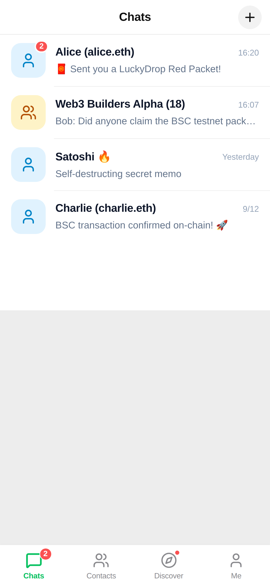
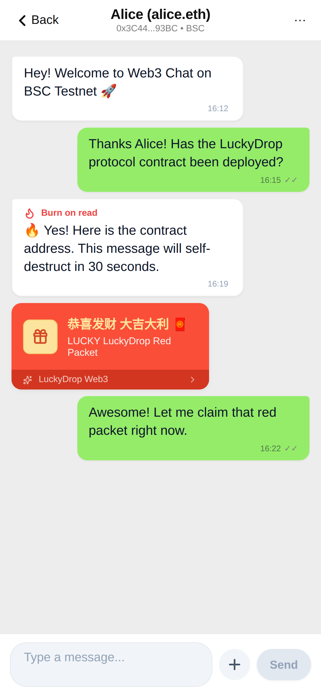
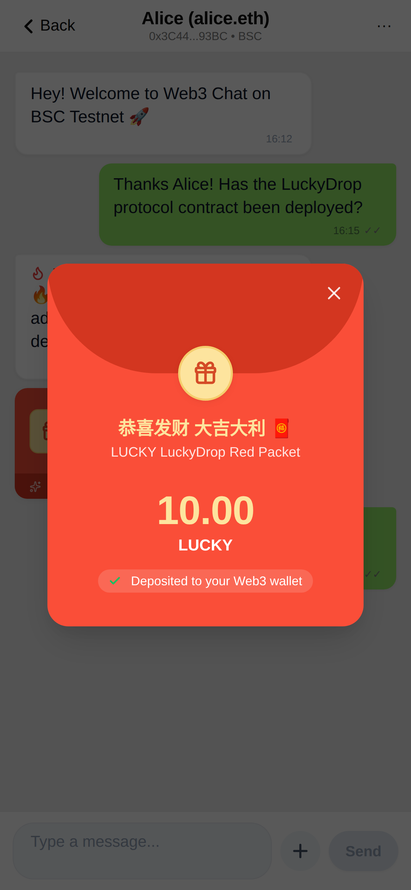
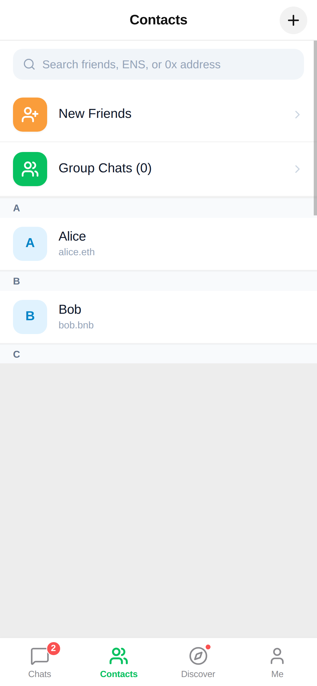
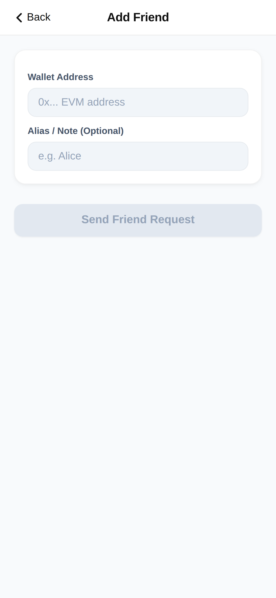
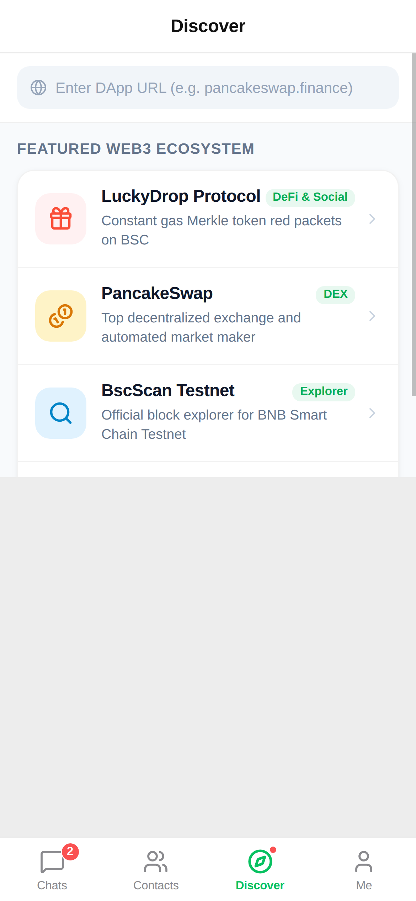
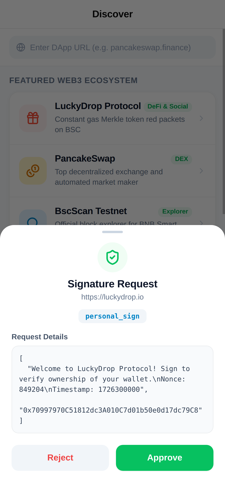
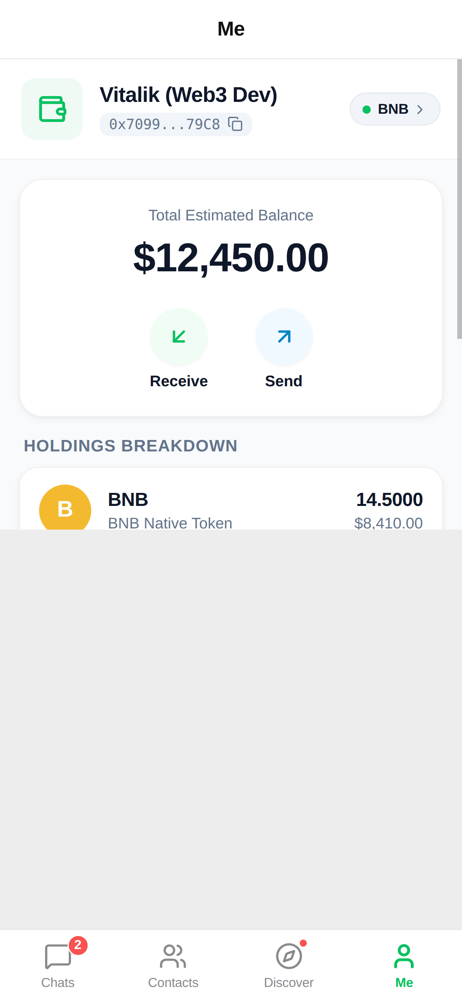
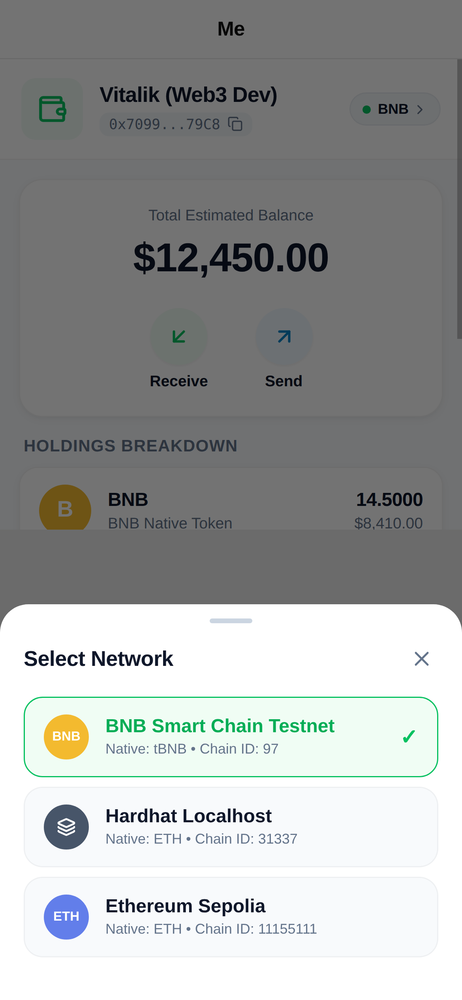

# Web3 Chat (微信风格 Web3 去中心化移动社交 App)

[](https://expo.dev)
[](https://reactnative.dev)
[](https://www.typescriptlang.org)
[](https://nodejs.org)
[]()
[]()
[]()

> 一款基于 **React Native + Expo (TypeScript)** 构建的移动端 Web3 社交应用，复刻微信经典绿色调 (`#07C160`) 4-Tab 交互体验，全面融入现代 Web3 矢量设计系统 (Lucide Icons + Squircle 超椭圆微阴影体系)，结合 Local-First 离线优先架构与非对称加密安全密钥管理，原生对接 BNB Smart Chain (BSC) 及周边 Web3 基础设施。

---

## 📱 视觉走查与真机界面展示 (Visual Showcase)

本项目具备完整的本地无头 Chrome 移动端视口自动化测试套件（iPhone 15 比例 `390 × 844 pt`，`3x Retina` 高清像素比，触摸手势仿真），以下为真实自动化流水线采集的高保真真机截图：

### 1. 聊天流与 LuckyDrop 链上红包

| 💬 会话列表 (Chats) | 💬 聊天流 & 红包 (Chat Detail) | 🧧 LuckyDrop 拆红包 (Claim Modal) |
|:---:|:---:|:---:|
|  |  |  |
| **现代矢量图标与 Squircle 头像**<br/>Lucide 矢量搜索与加号、精细化平滑微阴影、置顶与单/群聊角标 | **现代双向气泡与金箔红包卡**<br/>Lucide 快捷发送面板、🔥 30s 销毁倒计时、LuckyDrop 专属烫金卡片 | **毛玻璃悬浮拆红包模态框**<br/>高饱和金币微质感徽章、渐变 Claim 交互、常数级 Gas Merkle 证明 |

---

### 2. 链上社交发现与通讯录

| 👥 通讯录分组 (Contacts) | ➕ 添加朋友 (Add Friend) | 🧭 发现页面 (Discover) |
|:---:|:---:|:---:|
|  |  |  |
| **A-Z 索引与矢量生态入口**<br/>Lucide 柔和彩色圆角功能入口、Squircle 好友头像、ENS 备注 | **快捷扫码与地址校验面板**<br/>内置快速粘贴与扫码入口、EVM 0x 格式智能感知与校验提示 | **精选 DApp 现代磁贴矩阵**<br/>Lucide 矢量外链与徽标、分类标签、LuckyDrop & DEX 生态直达 |

---

### 3. Web3 安全签名与多链资产

| 🛡️ 签名授权抽屉 (Sign Sheet) | 👤 个人中心与多链资产 (Me) | 🌐 切换网络面板 (Chain Switch) |
|:---:|:---:|:---:|
|  |  |  |
| **安全加固防钓鱼签名抽屉**<br/>高危安全警示、等宽十六进制报文预览盒与一键复制、二次授权确认 | **Web3 渐变卡片与多链资产**<br/>深绿渐变钱包卡片、快捷操作矩阵 (转账/收款/扫码/发红包)、Multicall3 资产看板 | **现代网络选择器与活跃状态**<br/>Lucide 动态网络节点指示、绿色激活勾选徽章、主备 RPC 实时状态 |

---

## ✨ 核心功能矩阵

### 1. 微信级 4-Tab 核心体验与现代化设计
- **经典绿色调与现代设计规范**: 以微信经典绿 (`#07C160`) 统领全局，深度融入 Lucide 矢量图标库、平滑超椭圆圆角 (Squircle)、高保真毛玻璃悬浮抽屉与微阴影卡片体系，告别生硬字符与粗糙线框。
- **Chats (聊天)**: 会话列表下拉刷新、会话置顶、未读红点计数、单聊与群聊会话区分。
- **Contacts (通讯录)**: A-Z 拼音/英文字母分组排序、右侧首字母快速吸顶索引、新的朋友与群聊快捷入口。
- **Discover (发现)**: 内置 Web3 DApp 离线主页，涵盖 LuckyDrop Protocol、PancakeSwap、BscScan、BNB 官方水龙头。
- **Me (我)**: 钱包账户渐变卡片、截短地址一键复制、多链资产总览与网络切换抽屉。

### 2. Local-First 离线优先消息系统
- **状态流转闭环**: 严格走通 `pending` (离线暂存) ➔ `sent` (已投递) ➔ `delivered` (已送达) ➔ `read` (已读)。
- **双存储物理擦除**: 针对阅后即焚（🔥 30s 销毁），生命周期到期后触发双端本地 SQLite/内存与远端 Worker D1 的物理擦除。
- **30 秒撤回机制**: 本地与云端时间戳校验，30 秒内允许撤回消息并广播撤回指令。
- **周期增量同步 (`/sync`)**: 基于毫秒级复合时间戳游标协调器，断网恢复自动重传与拉取差量。

### 3. Web3 与密码学安全
- **私钥与助记词自持**: 基于 BIP-39 生成标准 12 词助记词，硬件级隔离存储 (`expo-secure-store`)，内存 Signer 严格生命周期管理（防泄漏清除堆缓存）。
- **EIP-191 SIWE 认证**: 客户端生成登录挑战报文并离线签名，免私钥触网换取 7 天安全 Bearer Token。
- **EIP-1193 Inpage 注入与安全抽屉**: WebView 内嵌 DApp 浏览器自动注入 `window.ethereum`，所有 `personal_sign` 与交易请求均弹出防钓鱼微信式安全抽屉进行二次人工确认。

### 4. 深度周边生态协同
- **LuckyDrop 链上红包 (`@luckydrop/sdk`)**:
  - 支持常数级 $O(1)$ Gas 的 Merkle 树代币红包创建。
  - 聊天流专属金红红包卡片，支持单聊与群聊开红包，自动链上校验 Merkle Proof 并一键 Claim。
- **链上社交合约 (`web3-chat-contract`)**:
  - 对接 `ChatStorageFactory` 智能合约，支持链上 Profile 设置、链上双向好友申请与群组主权治理。
- **多链 EVM 交互基座 (`evm-call`)**:
  - 客户端多链交互底层统一收口至 `evm-call`，内置主备 RPC 自动故障转移。
  - 集成 Canonical Multicall3 实现跨合约代币余额原子级批量读取。

---

## 🏛️ 系统架构与生态模块

```
                             +-------------------------------+
                             |    web3-chat (移动端 App)     |
                             |  React Native + Expo 52 (TS)  |
                             +---------------+---------------+
                                             |
         +-------------------+---------------+-------------------+-------------------+
         |                   |                                   |                   |
         v                   v                                   v                   v
+-----------------+ +-------------------+               +-----------------+ +-----------------+
|    evm-call     | | web3-chat-worker  |               |web3-chat-contr't| |    LuckyDrop    |
| (EVM交互/多链)  | |  (D1瞬态流转/R2)   |               | (链上好友/群组) | |  (Merkle红包)   |
+-----------------+ +-------------------+               +-----------------+ +-----------------+
         |                   |                                   |                   |
         +-------------------+-----------------+-----------------+-------------------+
                                               |
                                               v
                                    +--------------------+
                                    |  BSC Testnet (97)  |
                                    |   / Local Anvil    |
                                    +--------------------+
```

---

## 🚀 快速开始与环境要求

### 环境要求
- **Node.js**: `>= 22.0.0`
- **包管理器**: `pnpm` (`12.x` 或 `>= 9.x`)
- **本地浏览器**: Google Chrome 或 Chromium (用于运行 Visual E2E 走查)
- **链上测试套件**: Foundry (`anvil`, 仅全生态实机联测需要)

### 1. 安装依赖
```bash
pnpm install
```

### 2. TypeScript 类型检查
```bash
pnpm typecheck
```

### 3. 运行全量单元与集成测试 (Vitest)
运行 15 大核心测试套件，涵盖类型系统、存储引擎、KeyStore、SIWE 认证、聊天引擎、红包、通讯录、DApp 浏览器及安全审计用例：
```bash
pnpm test
```

### 4. 运行 Visual E2E 移动端视口走查与截屏
自动编译 Web 容器，拉起本地无头 Google Chrome (CDP)，精准模拟 iPhone 15 视口并自动采集输出 9 张高保真截图至 `test/visual/screenshots/`：
```bash
pnpm test:visual
```

### 5. 启动本地多仓库全生态实机联测 (Anvil)
无 Mock 贯通本地 Anvil (8548) 私有链、部署全套合约、拉起 Worker 运行时并完成 9 大基线 Stage 与 6 大高复杂度对抗场景实机验证：
```bash
pnpm test:joint
# 或直接执行
./local-joint-test/run.sh
```

### 6. 启动开发服务器
```bash
# 启动 Expo 开发服务
pnpm start

# 在浏览器中预览 Web 端
pnpm web

# 在 Android 模拟器/设备中运行
pnpm android

# 在 iOS 模拟器中运行 (仅 macOS)
pnpm ios
```

---

## 📂 核心代码目录索引

```
web3-chat/
├── App.tsx                               # 应用根入口 (挂载 VisualHarness / RootNavigator)
├── app.json                              # Expo 52 工程配置文件
├── package.json                          # 依赖与 scripts 配置
├── src/
│   ├── components/common/                # 微信风格通用组件 (HeaderBar, Badge, Icon 统一矢量桥)
│   ├── constants/                        # 链配置 (SUPPORTED_CHAINS)
│   ├── features/                         # 业务核心功能模块
│   │   ├── assets/                       # “我”页面与 Multicall3 资产全景服务
│   │   ├── chat/                         # 聊天会话列表、气泡流、输入栏、调度引擎与轮询
│   │   ├── contacts/                     # 通讯录、A-Z 排序、添加好友
│   │   ├── discover/                     # 发现页、内嵌 DApp 浏览器、EIP-1193 桥与签名弹窗
│   │   └── packet/                       # LuckyDrop 链上红包卡片、创建弹窗与 Claim 结果弹窗
│   ├── navigation/                       # 微信风格 4-Tab 路由骨架 (TabNavigator, RootNavigator)
│   ├── services/                         # 底层技术服务
│   │   ├── evm/                          # 基于 evm-call 的多链与 RPC 故障转移服务
│   │   ├── storage/                      # 离线优先持久化存储引擎 (会话/消息/游标)
│   │   ├── wallet/                       # KeyStore 本地安全密钥管理与钱包核心
│   │   └── worker/                       # Worker 客户端与 EIP-191 SIWE 认证
│   ├── theme/                            # 经典微信视觉主题与现代设计规范 (colors, design)
│   ├── types/                            # 领域模型与 TypeScript 定义
│   └── visual/                           # 视觉测试与真机环境演示容器 (VisualHarness)
├── test/                                 # 测试套件
│   ├── e2e/                              # 端到端联合业务流测试
│   ├── features/                         # UI 与业务特性组件测试
│   ├── services/                         # 底层服务与安全加固专项测试
│   └── visual/                           # Visual E2E 自动化测试驱动与全套截图
└── local-joint-test/                     # 本地多仓库无 Mock Anvil 实机联测工程
```

---

## 🔒 安全审计与加固要点

在 **TASK-015** 专项安全与性能加固中，本项目已完成深度审计与闭环优化：
1. **防内存私钥驻留**: `WalletCoreService` 增加 `clearSignerCache` 机制，在账户切换或销毁时立即清除堆内存中的 Signer 实例。
2. **跨平台兼容与防注入**: 彻底移除非标准 `Buffer.from`，全面使用 `viem` 原生转换；对 EIP-1193 注入脚本实施防原型链逃逸与转义。
3. **EIP-1193 `personal_sign` 参数鲁棒性**: 智能兼容 `[message, address]` 与 `[address, message]` 参数倒置场景，杜绝签名参数错位。
4. **批量 I/O 与并发优化**: 消除 $O(N)$ 串行读写，全面采用批量索引合并写入与 `Promise.all` 并发数据读取；消息组件全面接入 `React.memo` 阻断非必要重渲染。

---

## 📄 License
MIT License. Built with ❤️ for the Web3 Social Ecosystem.
