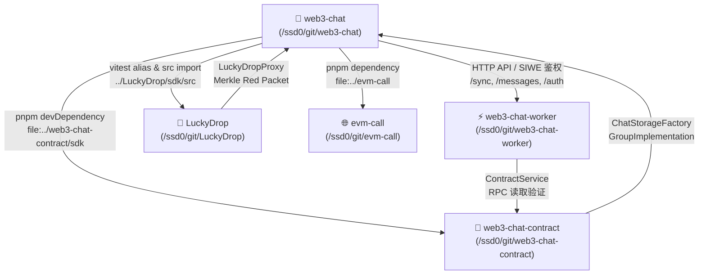

# Web3 Chat 本地多仓库依赖全景与跨仓库调试指南

> **文档目的**: 本文档系统梳理 `web3-chat` 依赖的所有本地代码仓库、文件目录、符号链接、构建产物与连接机制。当在开发或联调中遇到问题时，提供标准化的根因排查路径（Root-Cause Analysis）以及跨仓库修改、重新构建与同步验证的标准工作流。

---

## 1. 本地依赖全景拓扑图



---

## 2. 5 大依赖仓库详单与连接机制

### 2.1 主项目：`web3-chat` (当前仓库)
- **本地绝对路径**: `/ssd0/git/web3-chat`
- **核心定位**: 基于 React Native + Expo 的仿微信 4-Tab 移动端 App（Chat、Contacts、Discover、Me），内置离线优先存储、消息调度引擎与安全钱包管理。
- **关联 GitHub 账号**: `xzsean666`

---

### 2.2 `evm-call` (统一轻量级 EVM RPC 基座)
- **本地绝对路径**: `/ssd0/git/evm-call`
- **引用方式**:
  - `package.json` dependencies: `"evm-call": "file:../evm-call"`
- **输出产物**:
  - `dist/index.js`、`dist/index.d.ts` (由 `pnpm run build` 生成)
- **核心提供功能**:
  - `EvmCallClient`: RPC 连接池、健康检查、节点避退与熔断。
  - `multicall()`: 原生支持 Multicall3 `aggregate3` 批量合并调用（单次 RPC 往返）。
  - `findLatestBlockNumber()`, `getFeeHistory()`: 区块与 Gas 费用历史。
- **关联源码位置**:
  - `src/client/EvmCallClient.ts`
  - `src/pool/RpcPool.ts`
  - `src/multicall/Multicall3Codec.ts`

---

### 2.3 `web3-chat-contract` (链上社交与主权身份协议)
- **本地绝对路径**: `/ssd0/git/web3-chat-contract`
- **引用方式**:
  - **SDK 依赖**: `package.json` devDependencies: `"@web3-chat/sdk": "file:../web3-chat-contract/sdk"`
  - **测试 Artifact 引用**:
    - `out/ChatStorageFactory.sol/ChatStorageFactory.json`
    - `out/UserImplementation.sol/UserImplementation.json`
    - `out/GroupImplementation.sol/GroupImplementation.json`
    - `out/RelationshipManager.sol/RelationshipManager.json`
    - `out/Multicall3.sol/Multicall3.json`
- **核心提供功能**:
  - `@web3-chat/sdk`: `ChatSDK` 客户端，封装了身份克隆创建、好友请求发起/接受、群组创建/成员管理/禁言/踢人。
  - ABI 导出: `ChatStorageFactoryABI`, `RelationshipManagerABI`, `UserImplementationABI`, `GroupImplementationABI`。
- **关联源码位置**:
  - 智能合约: `contracts/*.sol`
  - SDK 源码: `sdk/src/*.ts`
  - 编译输出同步脚本: `scripts/sync-artifacts.js`

---

### 2.4 `LuckyDrop` ($O(1)$ 常数级 Gas 代币红包协议)
- **本地绝对路径**: `/ssd0/git/LuckyDrop`
- **引用方式**:
  - **SDK 别名映射**: `vitest.config.ts`:
    ```ts
    alias: {
      '@luckydrop/sdk': path.resolve(__dirname, '../LuckyDrop/sdk/src'),
    }
    ```
  - **测试 Artifact 引用**:
    - `contracts/artifacts/src/LuckyDrop.sol/LuckyDrop.json`
    - `contracts/artifacts/src/mocks/LuckyDropProxy.sol/LuckyDropProxy.json`
    - `contracts/artifacts/src/mocks/MockERC20.sol/MockERC20.json`
- **核心提供功能**:
  - `@luckydrop/sdk`: `LuckyDropClient`、`createPacket`、`claim`、`refund`、`verifyProof`、`PacketType` (FIXED 等额 / RANDOM 拼手气)。
  - Merkle 树生成与证明: 离线构建包含所有接收者地址与分配金额的 Merkle Tree。
- **关联源码位置**:
  - 合约源码: `contracts/src/LuckyDrop.sol`
  - SDK 源码: `sdk/src/client.ts`, `sdk/src/packet.ts`

---

### 2.5 `web3-chat-worker` (服务端中继、瞬态流转与 SIWE 鉴权)
- **本地绝对路径**: `/ssd0/git/web3-chat-worker`
- **引用方式**:
  - 生产环境: HTTP REST API 网络请求 (`src/services/worker/WorkerApiClient.ts`)。
  - 本地联合测试环境: 动态加载内存 Hono App 实例 (`deployAllProtocols.ts` 中的 `workerModule.app.request(...)`)，搭配本地 SQLite D1 模拟器与 R2 内存模拟器。
- **核心提供功能**:
  - `/auth/nonce`, `/auth/verify`: EIP-191 SIWE 挑战-应答登录，颁发 Bearer JWT。
  - `/sync`: 增量消息、回执与撤回状态同步游标流。
  - `/messages`: 文本投递、已读回执、30 秒撤回、阅后即焚倒计时触发。
  - `/voice`, `/images`, `/files`: 多媒体 R2 双存储流式上传与下载。
  - `SweeperService`: 物理双存储擦除定时服务。
- **关联源码位置**:
  - 路由: `src/routes/auth.ts`, `src/routes/sync.ts`, `src/routes/messages.ts`
  - 业务层: `src/services/auth.ts`, `src/services/sync.ts`, `src/services/sweeper.ts`
  - 测试辅助: `test/helpers/db.ts`, `test/helpers/r2.ts`

---

## 3. 常见问题排查与根因定位指南

| 故障现象 | 优先排查的代码库 | 关键排查路径与文件 | 典型根因与解决方案 |
|---|---|---|---|
| **EIP-191 SIWE 登录报 401 Unauthorized** | 1. `web3-chat-worker`<br/>2. `web3-chat` | 1. `web3-chat-worker/src/routes/auth.ts`<br/>2. `web3-chat/src/services/worker/AuthService.ts`<br/>3. `web3-chat/src/services/wallet/WalletCoreService.ts` | **根因 1**: Nonce 已被使用过（防重放机制触发），需重新拉取 nonce。<br/>**根因 2**: `signMessage(message, address)` 参数顺序传反导致恢复签名者失败。<br/>**根因 3**: 挑战语句 statement 与签名时不完全一致。 |
| **消息发送被拒绝，报 `PERMISSION_DENIED` 或 `BLOCKED`** | 1. `web3-chat-worker`<br/>2. `web3-chat-contract` | 1. `web3-chat-worker/src/services/conversation.ts`<br/>2. `web3-chat-contract/contracts/RelationshipManager.sol` | **根因**: 目标接收者已在链上将发件人列入黑名单，或发件人非目标群组成员/已被禁言。在合约中排查 `isBlacklisted()` 或 `isMuted()`。 |
| **`/sync` 增量同步消息漏单或跨页截断** | `web3-chat-worker` | `web3-chat-worker/src/services/sync.ts` | **根因**: Worker 原生使用秒级 `created_at > since`。当单秒内有大于分页大小的消息涌入时，下一页由于以该秒时间戳为游标，会跳过该秒后续消息。可将游标调整为毫秒级或 `(created_at, id)` 复合游标。 |
| **Multicall3 批量调用报错 `Multicall3 aggregate3 return data is too short`** | 1. `evm-call`<br/>2. `web3-chat-contract` | 1. `evm-call/src/client/EvmCallClient.ts`<br/>2. `web3-chat-contract/contracts/Multicall3.sol` | **根因**: 本地私有链（如 Anvil）默认没有在 `0xcA11bde05977b3631167028862bE2a173976CA11` 预置合约字节码。需使用 `anvil_setCode` 注入 Multicall3 字节码。 |
| **`evm-call` 报 `Invalid blockNumber format: latest`** | `evm-call` | `evm-call/src/domain/multicallModels.ts` | **根因**: `evm-call` 的 Zod 校验要求 blockNumber 必须为十进制数值、BigInt 或 Hex，不能为 `'latest'`。需先调用 `getBlockNumber()` 获取确切区块高度后传入。 |
| **红包领取 Revert `InvalidProof` 或无法 Claim** | 1. `LuckyDrop`<br/>2. `web3-chat` | 1. `LuckyDrop/contracts/src/LuckyDrop.sol`<br/>2. `LuckyDrop/sdk/src/packet.ts`<br/>3. `web3-chat/src/features/packet/LuckyDropService.ts` | **根因 1**: Merkle 叶子节点哈希计算中未包含 `msg.sender`，或传入了其他人的 Proof（防冒领触发）。<br/>**根因 2**: 代币未授权足够额度给 `LuckyDropProxy`。<br/>**根因 3**: 红包已超期，需先检查 `expireAt`。 |
| **红包超时退款 Revert `PacketNotExpired` (0x89c7b8c0)** | 1. `LuckyDrop`<br/>2. 本地测试链时钟 | 1. `LuckyDrop/contracts/src/LuckyDrop.sol` (Line 221)<br/>2. 测试套件中的 `evm_increaseTime` | **根因**: 合约严格要求 `block.timestamp >= expireAt`。在测试环境中，仅增加数秒可能因区块时间抖动不足以越过到期时间，需跃迁足够时长（如 +300 秒）并 `evm_mine`。 |
| **本地单元测试报错 `EADDRINUSE 8548`** | `local-joint-test` | `local-joint-test/run.sh` 与 `deployAllProtocols.ts` | **根因**: Vitest 默认并发执行测试文件，两个测试套件同时拉起 Anvil 端口冲突。必须使用 `run.sh` 串行执行，或执行 `fuser -k 8548/tcp` 清理残留进程。 |

---

## 4. 跨仓库修改、编译与生效标准工作流

如果在 `web3-chat` 的运行或测试中，定位到根因在其他仓库（如 `web3-chat-contract`、`LuckyDrop`、`evm-call` 或 `web3-chat-worker`），请遵循以下标准流程进行修改与产物同步：

### 流程 A: 修改 `evm-call` (底层 RPC 基座)
1. 进入目录并编辑代码：
   ```bash
   cd /ssd0/git/evm-call
   # 修改 src/ 下的代码...
   ```
2. 运行单元测试并重新编译构建：
   ```bash
   pnpm test
   pnpm run build
   ```
   > 构建产物输出在 `/ssd0/git/evm-call/dist/`，由于 `web3-chat` 的 `package.json` 使用了 `file:../evm-call`，修改编译后将立即生效。
3. 返回 `web3-chat` 执行校验：
   ```bash
   cd /ssd0/git/web3-chat
   pnpm typecheck
   pnpm test
   ```

---

### 流程 B: 修改 `web3-chat-contract` (智能合约或 `@web3-chat/sdk`)
1. **修改智能合约 (`contracts/*.sol`)**:
   ```bash
   cd /ssd0/git/web3-chat-contract
   # 修改 contracts/ 中的 .sol 文件...
   pnpm run build:contracts # 编译合约并同步 JSON artifact 到 out/
   ```
2. **修改 TypeScript SDK (`sdk/src/*.ts`)**:
   ```bash
   cd /ssd0/git/web3-chat-contract
   # 修改 sdk/src/ 中的代码...
   pnpm run build:sdk       # 使用 tsup 编译出 dist/
   ```
3. **全量构建并验证合约单测**:
   ```bash
   pnpm run build           # 同时构建 contracts 与 sdk
   pnpm run test:all        # 确保合约和 SDK 单测全部通过
   ```
4. 返回 `web3-chat` 执行联合测试：
   ```bash
   cd /ssd0/git/web3-chat
   ./local-joint-test/run.sh
   ```

---

### 流程 C: 修改 `LuckyDrop` (红包合约或 `@luckydrop/sdk`)
1. **修改智能合约 (`contracts/src/*.sol`)**:
   ```bash
   cd /ssd0/git/LuckyDrop/contracts
   pnpm run compile         # Hardhat 编译输出至 artifacts/
   pnpm run test            # 运行合约单测
   ```
2. **修改 SDK (`sdk/src/*.ts`)**:
   ```bash
   cd /ssd0/git/LuckyDrop/sdk
   pnpm run build           # 编译生成 dist/
   pnpm test                # 运行 SDK 单元测试
   ```
3. 返回 `web3-chat` 验证：
   ```bash
   cd /ssd0/git/web3-chat
   pnpm test
   ./local-joint-test/run.sh
   ```

---

### 流程 D: 修改 `web3-chat-worker` (后端中继与存储)
1. 进入目录并修改业务代码：
   ```bash
   cd /ssd0/git/web3-chat-worker
   # 修改 src/routes/ 或 src/services/ ...
   ```
2. 运行 Worker 单元测试（使用内存 D1/R2 模拟）：
   ```bash
   pnpm test
   ```
3. 返回 `web3-chat` 验证全链路联调：
   ```bash
   cd /ssd0/git/web3-chat
   ./local-joint-test/run.sh
   ```

---

## 5. 常用验证与调试命令速查表

| 操作需求 | 执行命令 | 预期结果 |
|---|---|---|
| **一键运行全部多仓库实机联调（15 个场景）** | `./local-joint-test/run.sh` | 15 / 15 全部通过，耗时约 20s |
| **仅运行 9 大核心基线联合测试** | `pnpm vitest run local-joint-test/multiRepoJoint.test.ts` | 9 passed (7s) |
| **仅运行 6 大高复杂度与安全对抗测试** | `pnpm vitest run local-joint-test/complexJointCases.test.ts` | 6 passed (10s) |
| **运行 `web3-chat` 本地全量单元与集成测试** | `pnpm test` | 15 test files, 107 passed |
| **严格 TypeScript 静态类型检查** | `pnpm typecheck` | `tsc --noEmit` 0 错误 |
| **检查并强制释放 Anvil 8548 端口** | `fuser -k 8548/tcp` | 释放被占用的端口 |
| **检查 GitHub CLI 鉴权账号** | `gh auth status` | 当前激活账号必须为 `xzsean666` |
| **切换当前活跃 GitHub 账号为 xzsean666** | `gh auth switch --user xzsean666` | 确认切至 `xzsean666` |
