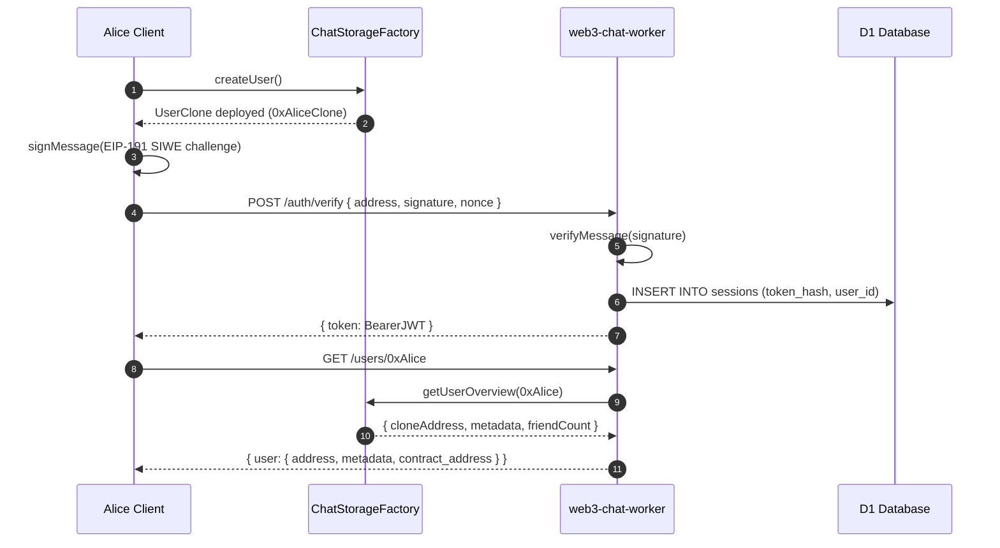
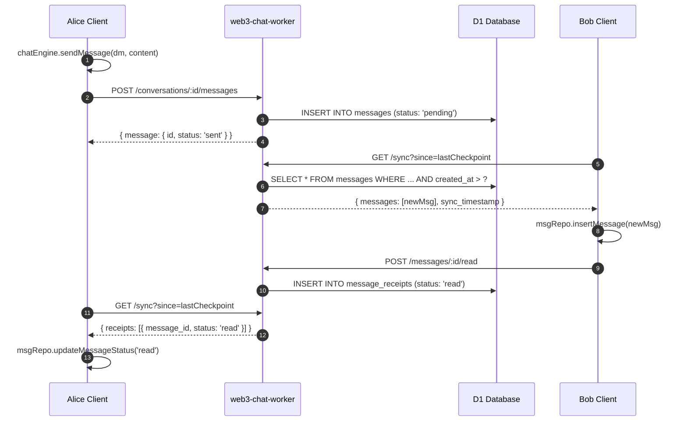
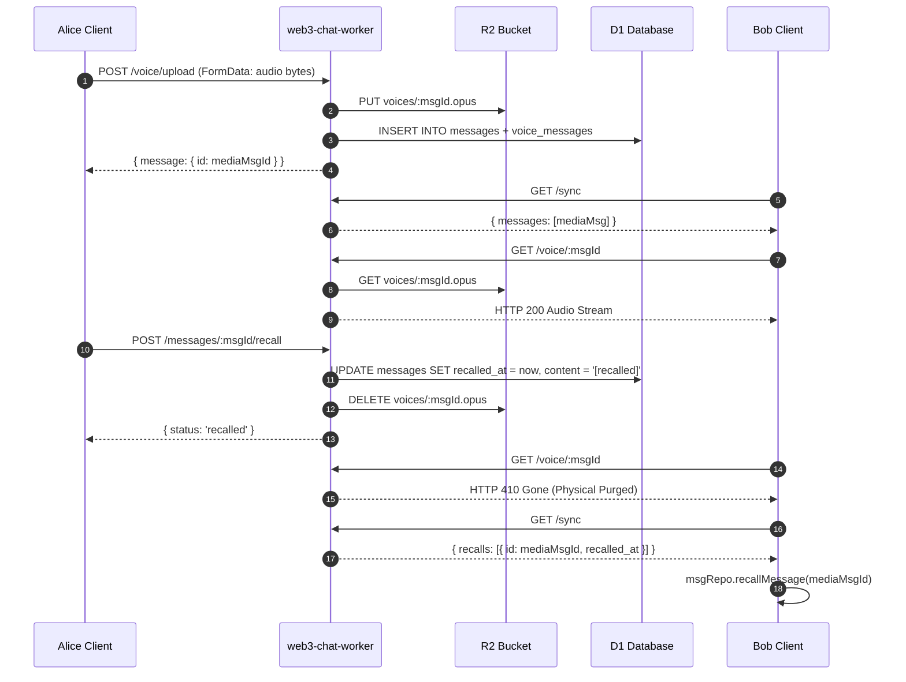
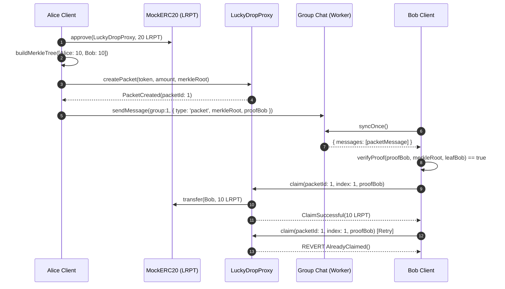

# Multi-Repo Joint Architecture & Integration Topology

本文档说明 `web3-chat` 联合测试工程涉及的 6 大代码仓库的系统架构拓扑、交互协议与端到端数据流。

---

## 1. 系统架构与仓库依赖拓扑

```mermaid
graph TD
    subgraph Client["前端客户端 (web3-chat)"]
        UI["React Native 4-Tab UI"]
        CE["ChatEngineService"]
        PS["PeriodicSyncService"]
        WC["WalletCore / KeyStore"]
        SC["SocialContractService"]
        LD["LuckyDropService"]
        DBRIDGE["Discover EIP-1193 Bridge"]
    end

    subgraph Relayer["服务端中继 (web3-chat-worker)"]
        Hono["Hono HTTP Router"]
        AuthMiddleware["EIP-191 Auth Guard"]
        D1["Cloudflare D1 (SQLite)"]
        R2["Cloudflare R2 (Audio/Media)"]
        WorkerCS["ContractService (On-Chain Verifier)"]
    end

    subgraph Contracts["链上协议层 (web3-chat-contract & LuckyDrop)"]
        Factory["ChatStorageFactory.sol"]
        UserClone["UserClone (EIP-1167)"]
        GroupClone["GroupClone (EIP-1167)"]
        RelMgr["RelationshipManager.sol"]
        LuckyProxy["LuckyDropProxy.sol (UUPS)"]
        LuckyImpl["LuckyDrop.sol"]
        Token["MockERC20 (LRPT)"]
    end

    subgraph Infra["底层设施 SDK (evm-call & EVM-Data-SDK)"]
        EvmCall["evm-call (RPC Pool & Multicall3)"]
        EvmData["EVM-Data-SDK (Multi-Provider Route)"]
        Anvil["Local Anvil Node (Port 8548)"]
    end

    UI --> CE
    UI --> SC
    UI --> LD
    UI --> DBRIDGE
    CE --> PS
    PS -->|"/sync, /messages"| Hono
    WC -->|SIWE Sign| Hono
    Hono --> AuthMiddleware
    AuthMiddleware --> D1
    Hono --> D1
    Hono --> R2
    Hono --> WorkerCS
    WorkerCS -->|JSON-RPC| Anvil
    SC -->|@web3-chat/sdk| EvmCall
    LD -->|@luckydrop/sdk| EvmCall
    DBRIDGE --> EvmCall
    EvmCall -->|HTTP RPC| Anvil
    Factory -.->|Clones| UserClone
    Factory -.->|Clones| GroupClone
    Factory <--> RelMgr
    LuckyProxy --> LuckyImpl
    LuckyImpl --> Token
    EvmData -.->|Config & Route| Anvil
```

---

## 2. 核心交互流时序图

### 2.1 链上身份与 SIWE 鉴权流 (Stages 2 & 3)



---

### 2.2 离线同步与消息确认流 (Stage 5)



---

### 2.3 语音 30 秒撤回与 R2 物理销毁流 (Stage 6)



---

### 2.4 LuckyDrop Merkle 红包群聊流 (Stage 8)


