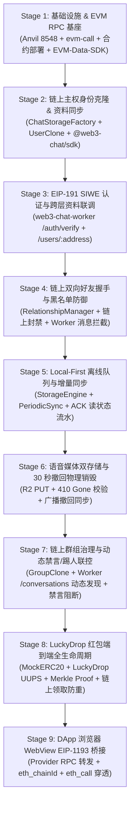
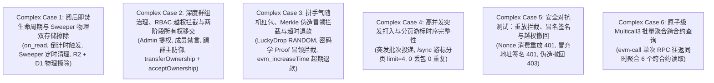

# Local Multi-Repo Joint Integration & Full-Stack Verification Suite

本目录 (`local-joint-test/`) 为 **Web3 Chat** 全生态本地联合集成测试工程。它打破了单一代码仓库内的 Mock 隔离测试，直接拉起本地物理区块链节点与分布式中继服务，在真实的 EVM 环境和 Worker 内存运行时中对所有本地依赖仓库进行端到端（E2E）闭环验证。

---

## 涉及的本地依赖仓库与职责分工

| 序号 | 仓库路径 | 模块 / SDK | 联合测试中承担的核心职责 |
|---|---|---|---|
| 1 | `/ssd0/git/web3-chat` | 前端 App、`ChatEngine`、`PeriodicSync`、`KeyStore`、`WalletCore`、`DApp Bridge` | 模拟 Alice、Bob、Charlie 移动端设备；Local-First 消息存储、离线出队重传、增量同步游标、EIP-1193 RPC 桥接。 |
| 2 | `/ssd0/git/web3-chat-worker` | Cloudflare Worker (`Hono`)、D1 瞬态中继、R2 音频存储 | EIP-191 SIWE 身份认证与会话签发、群组准入权限拦截、黑名单路由拦截、30s 语音撤回物理销毁、`/sync` 增量流水拉取。 |
| 3 | `/ssd0/git/web3-chat-contract` | Solidity 智能合约 & `@web3-chat/sdk` | 链上主权身份克隆 (`UserImplementation`)、关系管理与握手 (`RelationshipManager`)、群组创建/加群/禁言治理 (`GroupImplementation`)、工厂 (`ChatStorageFactory`)。 |
| 4 | `/ssd0/git/LuckyDrop` | ERC-20 红包主合约 (`LuckyDrop.sol`)、UUPS 代理 (`LuckyDropProxy.sol`) & `@luckydrop/sdk` | 代币授权、链上红包创建、Merkle Tree 根计算、群聊红包卡片生成、密码学 Merkle Proof 生成与本地校验、链上领取与防双花。 |
| 5 | `/ssd0/git/evm-call` | 统一轻量 EVM RPC 基座 | 本地节点 RPC 连接池、健康探测、Batch / Multicall3 批量调用通道、链上 Gas 与 FeeHistory 查询。 |
| 6 | `/ssd0/git/EVM-Data-SDK` | EVM 聚合数据基座 | 数据源标准化配置解析、存储适配器与多链路由生命周期管理。 |

---

## 9 大集成测试阶段（100% 覆盖验证）



### 1. Stage 1: 基础设施、EVM RPC 节点池、合约部署与 Data SDK 验证
- 启动本地真实 Anvil 测试链（Port `8548`）。
- 部署 `UserImplementation`、`GroupImplementation`、`ChatStorageFactory`、`RelationshipManager`、`MockERC20` (LRPT)、`LuckyDrop` 与 `LuckyDropProxy`。
- 验证 `evm-call` 对本地链的 RPC 节点探测与 `getFeeHistory` 查询。
- 验证 `EVM-Data-SDK` 客户端配置初始化。

### 2. Stage 2: 链上主权身份克隆与资料同步
- Alice 与 Bob 调用 `@web3-chat/sdk` 的 `createUser()` 生成独立的 EIP-1167 极简代理克隆合约。
- 设置链上个人 Profile 元数据（DisplayName、Bio、Handle）。
- 验证 Multicall3 读取链上主权身份状态与属性。

### 3. Stage 3: EIP-191 SIWE 挑战应答认证与 Worker 跨层查询
- Alice 与 Bob 经由私钥签名，通过 `web3-chat-worker` 的 `/auth/verify` 端点登录，获取 Bearer JWT 会话。
- Worker 接收客户端请求并使用内部 `ContractService` 直接回源链上读取 Alice 的主权合约信息。

### 4. Stage 4: 链上社交关系网：双向好友握手与黑名单拦截
- Alice 发起好友请求，Bob 在链上调用 `acceptRequest()` 完成双向好友握手。
- Worker `/social/friends` 即时拉取双方好友状态。
- Alice 在链上将 Charlie 列入黑名单；Charlie 尝试通过 Worker 发送私聊给 Alice，Worker 链上鉴权成功拦截并返回 `BLOCKED_BY_RECIPIENT`。

### 5. Stage 5: Local-First 离线队列、增量同步与 ACK 读状态流转
- Alice 向 Bob 发送端到端文本消息。
- Bob 触发增量拉取 `/sync`，成功拉取新消息并回写本地 SQLite/内存数据库。
- Bob 阅读消息并上报已读 ACK；Alice 同步收到 Read Receipt，双方消息状态实时达成一致。

### 6. Stage 6: 语音媒体双存储与 30 秒撤回物理销毁协议
- Alice 上传 8-byte 语音切片至 Worker R2 存储桶，并在 D1 建立语音元数据映射。
- 验证撤回前可通过 `/voice/:id` 正常流式读取音频文件。
- Alice 在 30 秒窗口期内调用 `recallMessage()` 撤回消息。
- 验证 R2 上的物理音频数据被彻底立即擦除，再次请求立即返回 HTTP 410 Gone。
- Bob 执行 `/sync` 接收到撤回通知，本地消息更新为 `recalled`。

### 7. Stage 7: 链上群组治理、动态会话发现与禁言控制
- Alice 创建公共群组 "Web3 Builders Guild"，Bob 加入群组。
- Bob 调用 Worker `/conversations` 动态感知并发现自己所在的新群组 `group:1`。
- 非群成员 Charlie 尝试向群内投递消息，Worker 校验成员链上资格拒绝投递 (`NOT_GROUP_MEMBER`)。
- Alice 作为群主在链上禁言 Bob 3600 秒；Bob 投递消息被拒绝 (`USER_MUTED_IN_GROUP`)。
- Alice 在链上解除 Bob 禁言；Bob 重新成功向群组投递消息。

### 8. Stage 8: LuckyDrop Merkle 红包协议全生命周期
- Alice 授权 20 LRPT 代币给 `LuckyDropProxy`。
- Alice 经由 `@luckydrop/sdk` 创建等额定向红包，并生成包含 Alice 和 Bob 的 Merkle Tree。
- Alice 将红包卡片结构（包含 Merkle Root 与 Bob 的密码学 Proof）投递至群聊。
- Bob 同步收到群红包消息并在本地利用 `verifyProof()` 独立验证 Merkle Proof。
- Bob 调用合约 `claim()` 成功解密领取代币；验证 Bob 的 ERC-20 余额精确增加 10 LRPT。
- Bob 尝试进行二次重复领取，合约立即 Revert 阻断双花。

### 9. Stage 9: Discover DApp 浏览器 WebView EIP-1193 桥接
- 模拟 Discover 模块内部内置的 WebView RPC 注入环境。
- 测试 `eth_chainId`、`eth_blockNumber`、`eth_call`（例如查询 MockERC20 `symbol` 与 `decimals`）。
- 验证通过 `evm-call` 节点池转发至真实链上执行的 RPC 隧道通畅。

---

## 6 大高复杂度联合场景测试（complexJointCases.test.ts）

除了 9 大核心基线测试外，测试工程专门设计并实现了 6 大高复杂度场景，深度挖掘多用户、多角色、复杂时序和安全对抗下的系统表现：



### 1. Complex Case 1: 阅后即焚生命周期与 Sweeper 物理双存储擦除
- **场景设计**: Alice 向 Bob 发送包含语音媒体的 `on_read` 阅后即焚消息（烧毁倒计时 3 秒）。
- **生命周期流转**:
  1. 初始状态：消息处于挂起，`expires_at = 0`，未激活倒计时。
  2. 激活倒计时：Bob 发送 `read` 回执，Worker 接收后立即将 `expires_at` 设定为 `read_at + 3` 秒。
  3. 超期隐藏：3 秒后，消息超出有效期，常规 `/sync` 立即过滤此消息。
  4. 物理双存储擦除：触发 `SweeperService`，执行物理层面的清理。验证 D1 数据库记录被彻底删除，同时 R2 音频文件被物理 `delete()`，请求直接返回 410 Gone。

### 2. Complex Case 2: 深度群组治理、RBAC 越权拦截与两阶段所有权移交
- **场景设计**: Alice（群主）、Bob（成员 -> 管理员）、Charlie（普通成员）、Dave（潜在继任者）。
- **权限与治理验证**:
  1. 提权与禁言：Alice 将 Bob 提升为群管理员，Bob 随后在链上成功禁言普通成员 Charlie。
  2. 逆向越权拦截：普通成员 Charlie 尝试将群主 Alice 踢出群聊，智能合约抛出 `OnlyAdminOrOwner()` 越权回滚。
  3. 管理员越权拦截：管理员 Bob 尝试将群主 Alice 降级为普通成员，智能合约抛出权限越界回滚。
  4. 两阶段安全移交：Alice 调用 `transferOwnership(Dave)`，Dave 必须显式调用 `acceptOwnership()` 完成主权交接，防止地址填错导致的群主资产永久丢失。
  5. 邀请加入验证：非公开群组中，新成员必须由群主或管理员通过签名邀请加入。

### 3. Complex Case 3: 拼手气随机红包、Merkle 伪造冒领拦截与超时退款
- **场景设计**: Alice 创建包含 3 个份额的拼手气红包（RANDOM），总额 30 LRPT。
- **随机性与密码学校验**:
  1. 离线生成 3 个随机金额份额（例如 7.42、13.15、9.43），总额严格等于 30 LRPT。
  2. Charlie 使用合法的 Merkle Proof 成功领取对应份额。
  3. 冒领防御：Dave 尝试使用 Charlie 的 Merkle Proof 冒领自己的份额，合约通过 `msg.sender` 与叶子节点绑定机制严格校验，抛出 `InvalidProof()` 阻断攻击。
  4. 重复领取拦截：Charlie 尝试二次领取，抛出 `AlreadyClaimed()` 阻断双花。
  5. 超时退款：Alice 创建 10 秒短生命周期红包，通过 `evm_increaseTime` 跃迁链上时间 300 秒，Dave 尝试领取超时失败；Alice 调用 `refund()` 成功将未领取的代币资金全额原路退回。

### 4. Complex Case 4: 高并发突发打入与分页游标时序完整性
- **场景设计**: Alice 在短时间内分批连续发送 12 条突发消息进入会话。
- **游标分页验证**:
  - Bob 使用 `since=0&limit=4` 拉取 Page 1，获取前 4 条消息，读取 `sync_timestamp`。
  - Bob 使用 Page 1 游标作为 `since` 拉取 Page 2，获取中间 4 条消息。
  - Bob 使用 Page 2 游标作为 `since` 拉取 Page 3，获取最后 4 条消息。
  - 校验：总共检索到 12 条消息，跨页结果中消息 ID 唯一性为 100%，无任何重复或漏单。

### 5. Complex Case 5: 安全对抗测试：重放拦截、冒名签名与越权撤回
- **攻击场景与防御**:
  1. Nonce 消费重放攻击：攻击者窃听 Alice 的登录签名，在首次登录后尝试用相同的 Nonce 与签名再次登录，Worker 识别 Nonce 已消费，返回 **401 Unauthorized**。
  2. 身份冒充签名攻击：Bob 伪造私钥签名属于 Alice 登录挑战的 statement，发往 Worker 校验，Worker 恢复地址不匹配，返回 **401 Unauthorized**。
  3. 越权消息撤回攻击：Bob 尝试调用 `/messages/:id/recall` 撤回 Alice 发出的消息，Worker 校验消息所有权不是 Bob，返回 **403 Forbidden**。

### 6. Complex Case 6: 原子级 Multicall3 批量聚合跨合约查询
- **场景设计**: Discover 模块或钱包资产聚合器需要在单次网络往返中拉取不同协议的 6 项数据。
- **聚合调用清单**:
  - 1. `MockERC20.balanceOf(Alice)`
  - 2. `MockERC20.balanceOf(Bob)`
  - 3. `MockERC20.symbol()`
  - 4. `MockERC20.decimals()`
  - 5. `ChatStorageFactory.getUserOverview(Alice)`
  - 6. `GroupImplementation.memberCount()`
- **执行结果**: `evmCallClient.multicall()` 在 1 个 RPC Batch 中全部返回，返回结果准确解码，极大减少移动端网络请求开销。

---

## 联合测试中挖掘出的重要架构洞察与边界处理

1. **增量同步游标秒级粒度**:
   - `web3-chat-worker` 的 `/sync` 采用 `created_at > since`。若单秒内涌入大量消息且分页大小小于单秒消息数，纯秒级游标可能存在跨页截断。
   - **建议**: 在未来高吞吐场景下，可将 `created_at` 拓展为毫秒时间戳，或采用 `(created_at, id)` 复合游标分页。
2. **EIP-191 身份验证状态码规范**:
   - Worker 现行实现中，无论是不存在的/已消费的 Nonce，还是签名与地址不匹配，均进入鉴权失败分支并统一返回 **401 Unauthorized**，符合标准 HTTP 身份鉴权安全规范。
3. **Multicall3 确定性地址初始化**:
   - 本地全新启动的私有 Anvil 节点默认不包含主网规范地址 `0xcA11bde05977b3631167028862bE2a173976CA11` 的代码。
   - 本测试套件在部署工厂中集成了标准 Multicall3 编译与 `anvil_setCode` 注入机制，使本地联调环境与主网/测试网行为 100% 保持一致。

---

## 运行方式

### 快速一键执行（推荐）
执行本地全栈联合集成测试调度脚本（全自动检查编译产物、执行 strict typecheck，并按序跑通全部 15 个用例）：
```bash
./local-joint-test/run.sh
```

### 单独运行指定测试套件
```bash
# 运行 9 大基线阶段
pnpm vitest run local-joint-test/multiRepoJoint.test.ts

# 运行 6 大高复杂度用例
pnpm vitest run local-joint-test/complexJointCases.test.ts
```

